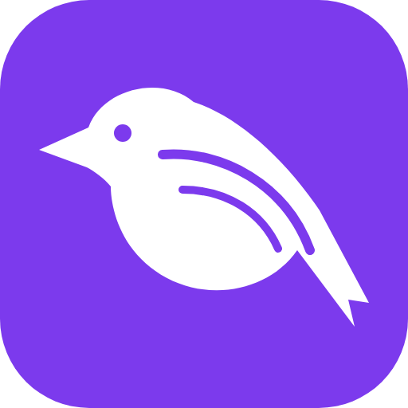

# magpie

[](https://github.com/JesseScott/magpie/releases/latest)

An Android web clipper for Obsidian.

Chrome on Android can't run the Obsidian Web Clipper extension. Magpie is a small installable web app (a PWA) that adds itself to Chrome's Share menu. Share a page or a text selection, tap **Save to Obsidian**, and a note lands in your vault.

## What a clip looks like

By default, notes are created in a `Clippings` folder in your vault:

```markdown
---
title: "Page title"
source: "https://example.com/page"
clipped: 2026-10-11
tags:
  - clippings
  - any-extra-tags
---

https://example.com/page

> Selected text, if any

Your note, if any
```

`clippings` is applied to every clip. The share screen has an optional field for extra tags, which are written to the same list. The folder, tag and property names are all configurable (see Settings).

## Install

1. In Chrome on Android, open **<https://jessescott.github.io/magpie/>**.
2. Chrome menu, then **Install app**.
3. Share any page from Chrome and pick **Magpie**.

All paths in the code are relative, so the app works under the `/magpie/` subpath it is served from.

Choose **Install**, not **Create shortcut**. A shortcut is only a bookmark and won't appear in the Share menu.

## Settings

The first time you open Magpie it asks where to save clips. Open **Settings** any time to change it.

| Setting | Default | Notes |
| --- | --- | --- |
| Vault name | blank | Exactly as Obsidian shows it (case matters). Blank uses whichever vault you opened last. |
| Folder | `Clippings` | A folder inside the vault. Blank saves to the vault root. |
| Tags added to every clip | `clippings` | Comma-separated, for example `clippings, magpie`. Blank adds no automatic tags. |
| Property name for the link | `source` | Letters, digits, `_` and `-`. |
| Property name for the clip date | `clipped` | Same rule. |
| Link at the top of the note | on | The link is always in the frontmatter. |

Settings are stored on your device and survive closing the app.

Shared links always lose their tracking parameters (`utm_*`, `fbclid`, `gclid`, YouTube's `si` and similar), and Google redirect links are unwrapped to where they point. Other parameters are kept.

## Privacy

Everything runs on your phone. Magpie has no server, no analytics and no account, and nothing you clip is sent anywhere except to Obsidian on the same device. The only network requests are the ones that load the app itself.

Magpie remembers the extra tags you use so it can suggest them next time. That list is stored in your browser on the phone, next to your settings, and **Forget recent tags** in Settings clears it.

## How it works

The share target in `manifest.webmanifest` receives `title`, `text` and `url`. `clip.js` builds the note and an `obsidian://new` link, and `app.js` opens it. Short notes travel inside the link. Notes too long for a link are copied to the clipboard and created with `obsidian://new?...&clipboard`.

No server and no build step. Phase 2 (full-article extraction through a Cloudflare Worker) is not built yet.

## Develop

Magpie has no build step and no runtime dependencies. Tests come in three layers:

```sh
npm test               # unit and static checks, Node's built-in runner, nothing to install
npm run test:e2e       # browser smoke tests in Chromium, see below
npm run check:version  # would CI ask for a version bump on this branch?
```

`npm test` covers `clip.js` and checks that the files GitHub Pages serves agree with each other (manifest, icons, service worker cache list).

`npm run test:e2e` drives the real screen in Chromium on a phone-sized viewport: first run, settings, tags, offline, and the exact `obsidian://` link the app builds. Install its dependencies once:

```sh
npm ci
npx playwright install chromium
```

The tests serve the repo under `/magpie/`, like GitHub Pages, so a path that only works at the site root fails too. They can't cover the Android share sheet, installing the app, or the handoff into Obsidian. [`docs/manual-checklist.md`](docs/manual-checklist.md) lists those for a phone check before a release.

Chrome only treats `localhost` and HTTPS as installable, so test sharing on a phone from the GitHub Pages deployment. After changing any served file, bump the version (see Releasing) so installed copies update.

## Releasing

The version lives in `version.js` and is shown at the bottom of the clip screen and of Settings. `package.json` must carry the same number (a test checks). The service worker names its cache after the version, so a new version replaces the old cache on its own.

1. Bump the version in `version.js` and `package.json`. Use a patch bump for fixes and a minor bump for new settings or features.
2. Open the pull request. CI fails a pull request that changes any served file (`index.html`, `app.js`, `clip.js`, `style.css`, `sw.js`, `manifest.webmanifest`, `icons/`) without raising the version. Run `npm run check:version` locally to see what CI will say. Changes to docs, tests and workflows need no bump.
3. Merge to `main` and wait for the Pages deploy. A workflow then tags `v<version>` and publishes a GitHub release with generated notes. To release the current version by hand, run the **Release** workflow from the Actions tab.
4. On the phone, open Magpie, close it fully, and open it again. The first launch after a deploy still shows the old version while the new one downloads, so the second launch shows the new number.

## Files

| File | Purpose |
| --- | --- |
| `index.html`, `style.css`, `app.js` | The share screen |
| `clip.js` | Parsing the share, building the note and the Obsidian link |
| `manifest.webmanifest` | Install metadata and the share target |
| `version.js` | The app version, shown in the UI and used to name the cache |
| `sw.js` | Offline cache, required for installing |
| `test/` | Unit and static tests (`npm test`) |
| `e2e/` | Browser smoke tests and the small server they use (`npm run test:e2e`) |
| `docs/` | Manual checklist for what the automated tests can't cover |

## License

MIT

## Support

Magpie is free. If it's useful to you, you can [buy me a coffee on Ko-fi](https://ko-fi.com/jessescott).
